<picture><source media="(min-width: 1012px)" srcset="assets/header.svg"></picture>

I take web products from an empty folder to people using them, and I'm looking for a junior full-stack role where the people around me know more than I do. On site in Veneto or remote. I can start now: [thadoom@icloud.com](mailto:thadoom@icloud.com).

<picture><source media="(min-width: 1012px)" srcset="assets/stats.svg"></picture>

<picture><source media="(min-width: 1012px)" srcset="assets/stack.svg"></picture>

Also in the repos: Zustand, Motion, three.js, D1, Server-Sent Events, node:test, ESLint, Wrangler, Direct2D, a SteamVR driver, and a Linux server I run myself.

## Five things I built in 2026

Click a bar to open it. One opens at a time, and inside each there is the product running as a small demo drawn in SVG, then the stack and the numbers. Most of this code is private: it holds client data, or it is closed source by choice. I'm glad to open the real thing on a call and walk through it.

01 of 05 · open Ombra <picture><source media="(min-width: 1012px)" srcset="assets/ombra-front.svg"></picture>

<a href="https://github.com/thadoom/ombra"><picture><source media="(min-width: 1012px)" srcset="assets/ombra.svg"></picture></a>

A free Windows app that turns IMU body trackers into full-body tracking in SteamVR. It replaces the vendor's own desktop software.

- The app is native Rust with a Direct2D window, so there is no browser engine inside. A C++ driver runs in SteamVR and the two talk over shared memory.
- It reads the trackers from their USB dongles, builds the body 250 times a second, smooths it with an adaptive One Euro filter and corrects drift while you move.
- About 65,000 lines of Rust and 12,000 of C++, with 292 Rust unit tests and scripts that score the filters on recorded sessions.
- 9 public releases between 5 and 14 November 2026. Each installer goes through VirusTotal and the report is linked from the release.

[Repository](https://github.com/thadoom/ombra) · [Website](https://thadoom.github.io/ombra/) · Free to use, closed source.

02 of 05 · open Game community platform <picture><source media="(min-width: 1012px)" srcset="assets/platform-front.svg"></picture>

<picture><source media="(min-width: 1012px)" srcset="assets/platform.svg"></picture>

The website and backend of a free, fan-made online game: accounts, leaderboards, news, a moderated media gallery, bans and appeals.

- The site is a Next.js 16 static export with 3D scenes in three.js.
- The API is one Cloudflare Worker with no runtime dependencies. It has a D1 (SQLite) database with 15 migrations, cron jobs, per-IP rate limits and Discord sign-in.
- 475 automated tests, 241 on the API and 234 on the site. GitHub Actions runs them on every push to main, and a red step stops the run before the deploy.
- 81 commits in 19 days. It's live.

A mistake I fixed: my first automatic ban rules flagged legitimate players. I switched automatic banning off. Bans are now decided by a person, and players can appeal.

03 of 05 · open Call-centre CRM <picture><source media="(min-width: 1012px)" srcset="assets/crm-front.svg"></picture>

<picture><source media="(min-width: 1012px)" srcset="assets/crm.svg"></picture>

Built for the call-centre team of a consulting firm in Northern Italy. Operators claim the companies they will call, log the outcome and book appointments. Admins see the whole floor live.

- 44 API routes on Next.js 16, PostgreSQL through hand-written SQL (16 tables) and a Redis cache.
- Live updates over Server-Sent Events: who is online, who claimed which company.
- Sessions with argon2-hashed passwords and a security-question reset.
- I moved the data from Firestore to PostgreSQL with import scripts, and wrote a company-data sync with a dry run, an automatic backup and a one-command restore.
- PDF export and Excel import. 21 commits, February to April 2026.

04 of 05 · open Market-stall stock app <picture><source media="(min-width: 1012px)" srcset="assets/stock-front.svg"></picture>

<picture><source media="(min-width: 1012px)" srcset="assets/stock.svg"></picture>

A phone-first PWA that tracks warehouse stock and what is on display at a street-market sweets stall. The staff use it at the stall.

- Next.js 16, React 19, Tailwind CSS 4 and Zustand, on Firestore with security rules and real-time sync.
- It installs on the phone. A service worker caches the app and shows an offline screen when the signal drops.
- Each deploy bumps the version and sends a Web Push to the phones, so they know an update is ready.
- Unit tests on the stock logic with Vitest. 19 commits, June to October 2026.

05 of 05 · open Company website rebuild <picture><source media="(min-width: 1012px)" srcset="assets/website-front.svg"></picture>

<picture><source media="(min-width: 1012px)" srcset="assets/website.svg"></picture>

A rebuild of the public website of the same consulting firm.

- It started from an SEO audit that is kept in the repo. Then came structured data, sitemap, robots rules and cookie consent.
- One deploy script builds the site and uploads it over FTP. It has a dry-run mode.
- 53 commits, March to April 2026.

Also public: [Schedule Maker](https://github.com/thadoom/njschedule), a small static tool that exports a weekly schedule as a 1920×1080 PNG. Plain JavaScript, no build step.

## How I got here

<picture><source media="(min-width: 1012px)" srcset="assets/path.svg"></picture>

No school taught me this. Around 2016 I started with TeamSpeak server bots, first JTS3ServerMod and then Python. I moved on to Discord bots, then to websites. All of it came from videos, documentation and hours of testing until the thing worked. AI coding tools arrived later, and with them I could build software the size of Ombra.

## How I work

I build with AI coding agents every day. Ombra and the game platform would not exist at this size without Claude Code. In the platform repo, 48 of 81 commits are co-signed by the agent. I would rather you hear it from me than find it in the git log.

My part is everything around the typing: deciding what to build and what to cut, writing the spec, testing on real hardware and with real users, chasing the bug, shipping the release, answering the people who use it.

Nothing reaches production on the game platform with a failing test. When I'm wrong I change course, and the ban rules in drawer 02 are one example. I don't like wasting time either: nine releases in ten days, 81 commits in nineteen.

What I want next is a team that reviews my code hard, and people better than me to learn from. I want this to be my job.

## Contact

<a href="mailto:thadoom@icloud.com"><picture><source media="(min-width: 1012px)" srcset="assets/contact.svg"></picture></a>

[thadoom@icloud.com](mailto:thadoom@icloud.com) · [github.com/thadoom](https://github.com/thadoom) · Veneto, Italy
