A: picture 100%, no text

<picture></picture>

inside A

B: picture 95% align middle

<picture></picture>

inside B

C: picture align right 97%

<picture></picture>

 

inside C

D: tabs in a table row

<table>
<tr>
<td width="20%">

<picture></picture>
<picture></picture>
</td>
<td width="20%">

<picture></picture>
<picture></picture>
</td>
</tr>
</table>

E: summary with h3

<h3>Ombra</h3>

<picture></picture>

<h3>Call-centre CRM</h3>

<picture></picture>

F: nested tabs inside, text summaries on one line?

Demo
<picture></picture>

Numbers
<picture></picture>

G: image links to anchors

<a href="#user-content-zone-b"><picture></picture></a> <a href="#zone-b"><picture></picture></a>

<h2 id="zone-b">Zone B</h2>

end
